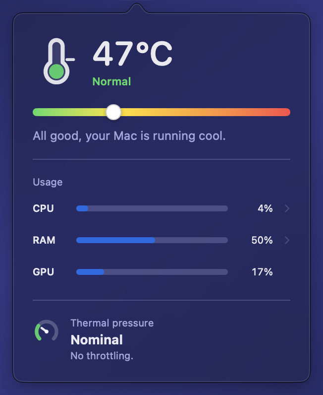
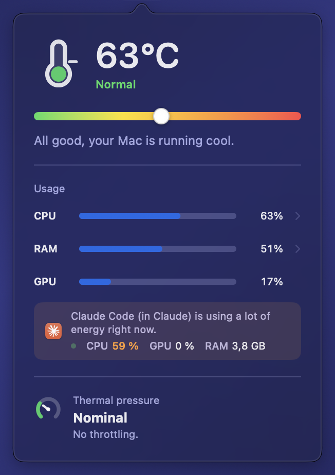
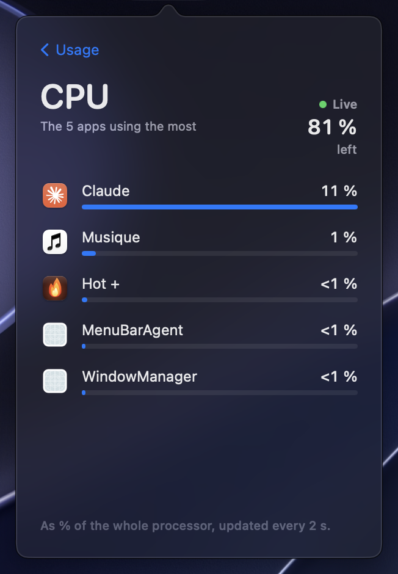
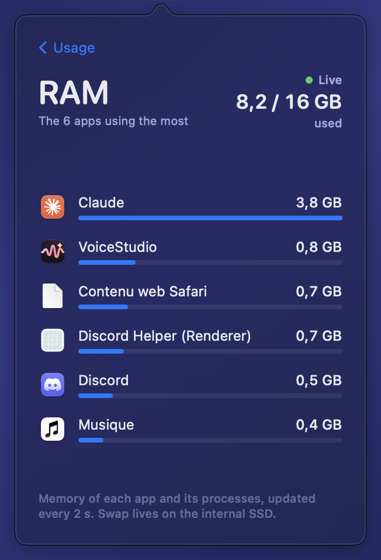
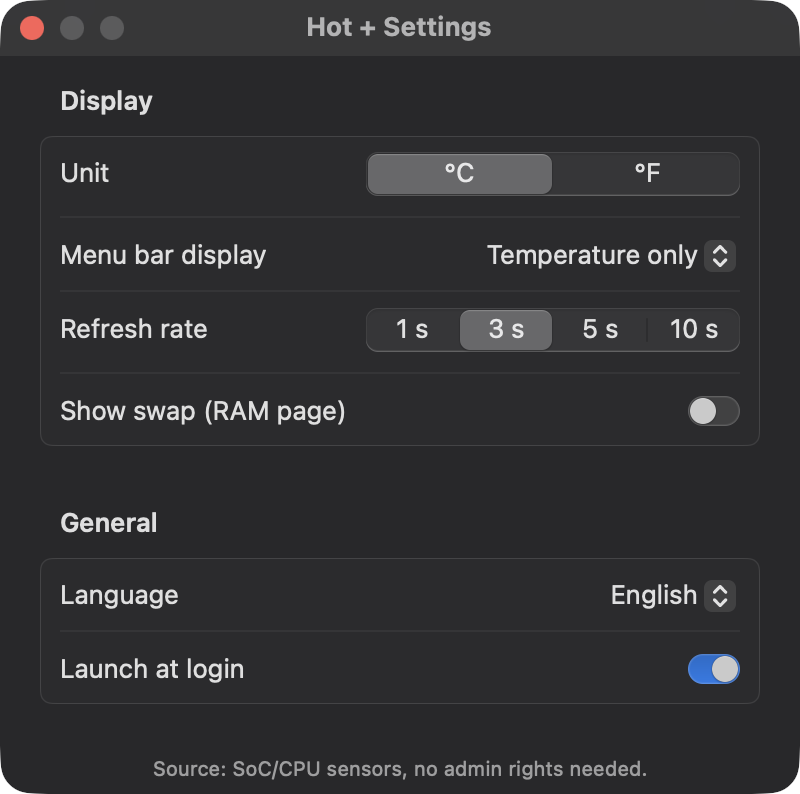

<p align="center">
  
</p>

<h1 align="center">Hot +</h1>

<p align="center">
  <strong>Is your Mac running hot? Now you know, right from the menu bar.</strong><br>
  <strong>Votre Mac chauffe-t-il ? Voyez-le en un coup d'œil, dans la barre de menus.</strong>
</p>

<p align="center">
  <a href="https://github.com/Ligrade/hot-plus/releases/latest"></a>
</p>
<p align="center">
  <sub>Free · .zip · macOS 13+ · Apple Silicon · <a href="#install">How to install</a> · <a href="#installation">Comment installer</a></sub>
</p>

<p align="center">
  <code>v1.2</code> · macOS 13+ · Apple Silicon only · Swift · Open source, free for use · By Ligrade
</p>

<p align="center">
  
  
</p>
<p align="center">
  
  
</p>
<p align="center">
  
</p>

---

## English

Hot + is a tiny menu-bar app for macOS. It shows the temperature of your Mac, tells you whether it is normal, displays the system's thermal pressure, and shows your CPU, GPU and RAM usage. No Dock icon, no dependencies, no `sudo`.

### Install

1. **[Download the latest Hot-Plus .zip](https://github.com/Ligrade/hot-plus/releases/latest)** and unzip it.
2. Move **Hot +.app** to **Applications**.
3. First launch: the app is not notarized, so right-click it → **Open** → **Open**. If macOS still blocks it: System Settings → Privacy & Security → **Open Anyway**.

### Features

- **Live temperature** in the menu bar, in °C or °F.
- **Verdict**: normal, warm, hot or critical, based on the temperature of your Apple Silicon chip.
- **Thermal pressure** reported by macOS: nominal, fair, serious, critical.
- **CPU, RAM and GPU usage** as live bars in the popover (hover RAM for used / total GB).
- **Top 5 apps**: click CPU or RAM to slide to the 5 apps using the most, with live values and the capacity left (free CPU %, free RAM GB).
- **Energy alert**: when an app uses a lot of energy, a small note names it (and the real tool, e.g. "Claude Code (in Claude)") with its live CPU, GPU and RAM. Measured like Activity Monitor's Energy tab, only while the popover is open.
- **Custom icons**: a thermometer for temperature and a dial for pressure, each in green, amber or red.
- **Menu bar display**: icon + temperature, temperature only, or icon only.
- **Refresh every 1, 3, 5 or 10 seconds** (3 s by default). Idle cost is close to 0 % CPU and about 15 MB of memory.
- **Launch at login** (optional).
- **English and French**, following your system language or set manually.

### Usage

| Action | Result |
|---|---|
| Left click | Popover: temperature, verdict, CPU / RAM / GPU usage, thermal pressure, energy alert |
| Click CPU or RAM | Top 5 apps for that resource, live (‹ Usage to go back) |
| Right click | About Hot + · Settings… · Quit |

**Settings**: unit (°C / °F), refresh rate, menu bar display, launch at login, language (System / English / Français).

### Build

Requires macOS 13+ and the Swift / Xcode command-line tools.

```bash
./build.sh            # builds "build/Hot +.app" (ad-hoc signed)
./build.sh --install  # also copies it to /Applications
open "build/Hot +.app"
```

"Launch at login" only works reliably when the app is in `/Applications`, so use `--install` first.
Set `HOTPLUS_LOG=1` to print the menu bar title to stdout (debug).

### How the temperature is read

Hot + reads the IOKit HID sensors of the chip (`PMU tdie*`, the SoC / CPU dies) and shows the highest reading. No `sudo` needed. If no sensor is readable, it falls back to thermal pressure only (dial icon and `—`).

> **Not compatible with Intel Macs.** Hot + is made for Apple Silicon (M1 and later). Temperatures are not supported on Intel.

### Temperatures (T)

| Verdict | Temperature | Icon |
|---|---|---|
| Normal | below 65 °C (149 °F) | green |
| Warm | 65 – 84 °C (149 – 183 °F) | amber |
| Hot | 85 – 99 °C (185 – 210 °F) | red |
| Critical | 100 °C (212 °F) and above | red |

### Thermal pressure

| macOS state | Meaning | Icon |
|---|---|---|
| Nominal | No thermal constraint | green |
| Fair | Slightly warm, system still at full speed | amber |
| Serious | The system starts slowing down | amber |
| Critical | Heavy throttling, let the Mac cool down | red |

> Hot + relies on private macOS APIs. That is fine for a personal build, but it is not compatible with the App Store.

---

## Français

Hot + est une petite app de barre de menus pour macOS. Elle affiche la température de votre Mac, indique si elle est normale, montre la pression thermique du système et l'utilisation du CPU, du GPU et de la RAM. Pas d'icône dans le Dock, aucune dépendance, pas de `sudo`.

### Installation

1. **[Téléchargez le dernier .zip de Hot +](https://github.com/Ligrade/hot-plus/releases/latest)** et décompressez-le.
2. Glissez **Hot +.app** dans **Applications**.
3. Premier lancement : l'app n'est pas notarisée, faites clic droit → **Ouvrir** → **Ouvrir**. Si macOS bloque encore : Réglages Système → Confidentialité et sécurité → **Ouvrir quand même**.

### Fonctionnalités

- **Température en direct** dans la barre de menus, en °C ou °F.
- **Verdict** : normale, tiède, chaude ou critique, selon la température de votre puce Apple Silicon.
- **Pression thermique** donnée par macOS : nominale, modérée, élevée, critique.
- **Utilisation CPU, RAM et GPU** en barres dans le popover (survolez la RAM pour voir Go utilisés / total).
- **Top 5 des apps** : cliquez sur CPU ou RAM pour glisser vers les 5 apps qui en utilisent le plus, avec les valeurs en direct et la capacité restante (CPU libre en %, RAM libre en Go).
- **Alerte énergie** : quand une app consomme beaucoup, une petite note la nomme (avec l'outil réel, par ex. « Claude Code (dans Claude) ») et affiche son CPU, GPU et RAM en direct. Mesuré comme l'onglet Énergie du Moniteur d'activité, seulement popover ouvert.
- **Icônes dessinées sur mesure** : un thermomètre pour la température et un cadran pour la pression, chacun en vert, ambre ou rouge.
- **Affichage dans la barre** : icône + température, température seule, ou icône seule.
- **Rafraîchissement toutes les 1, 3, 5 ou 10 secondes** (3 s par défaut). Au repos : environ 0 % de CPU et 15 Mo de mémoire.
- **Lancement au démarrage** (optionnel).
- **Anglais et français**, selon la langue du système ou réglable à la main.

### Utilisation

| Action | Résultat |
|---|---|
| Clic gauche | Popover : température, verdict, utilisation CPU / RAM / GPU, pression thermique, alerte énergie |
| Clic sur CPU ou RAM | Top 5 des apps pour cette ressource, en direct (‹ Utilisation pour revenir) |
| Clic droit | À propos de Hot + · Réglages… · Quitter |

**Réglages** : unité (°C / °F), fréquence, affichage dans la barre de menus, lancer au démarrage, langue (Système / English / Français).

### Compilation

Nécessite macOS 13+ et les outils en ligne de commande Swift / Xcode.

```bash
./build.sh            # produit « build/Hot +.app » (signature ad hoc)
./build.sh --install  # le copie aussi dans /Applications
open "build/Hot +.app"
```

« Lancer au démarrage » ne fonctionne bien que si l'app est dans `/Applications` : utilisez d'abord `--install`.

### Lecture de la température

Hot + lit les capteurs IOKit HID de la puce (`PMU tdie*`, SoC / CPU) et affiche la valeur la plus haute, sans `sudo`. Sans capteur lisible, il n'affiche que la pression thermique (cadran et `—`).

> **Non compatible avec les Mac Intel.** Hot + est conçu pour Apple Silicon (M1 et suivants). Les températures ne sont pas prises en charge sur Intel.

### Températures (T)

| Verdict | Température | Icône |
|---|---|---|
| Normale | moins de 65 °C (149 °F) | verte |
| Tiède | 65 – 84 °C (149 – 183 °F) | ambre |
| Chaude | 85 – 99 °C (185 – 210 °F) | rouge |
| Critique | 100 °C (212 °F) et plus | rouge |

### Pression thermique

| État macOS | Signification | Icône |
|---|---|---|
| Nominale | Aucune contrainte thermique | verte |
| Modérée | Un peu chaud, vitesse maximale conservée | ambre |
| Élevée | Le système commence à ralentir | ambre |
| Critique | Fort ralentissement, laissez refroidir le Mac | rouge |

> Hot + utilise des API privées de macOS : correct pour un usage personnel, incompatible avec l'App Store.

---

<p align="center">
  <strong>Hot + v1.2 · By Ligrade</strong> · <a href="https://github.com/Ligrade/hot-plus">github.com/Ligrade/hot-plus</a>
</p>
